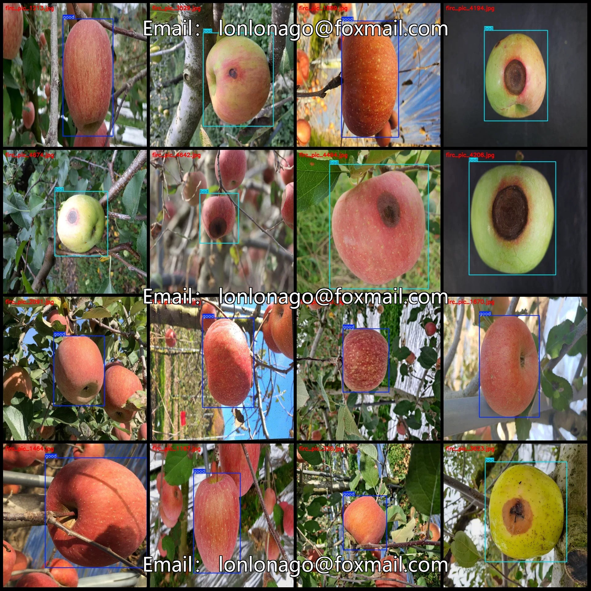
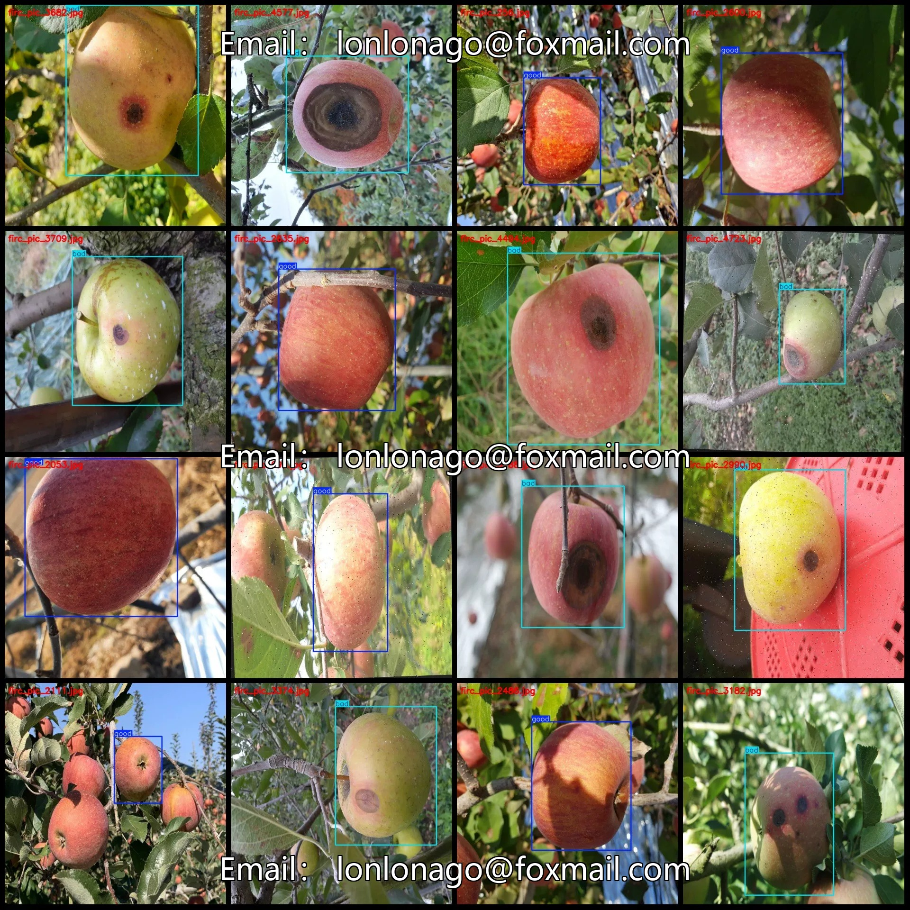
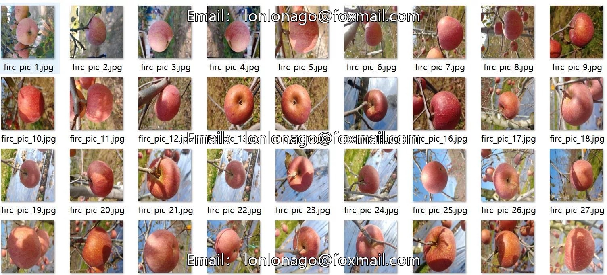
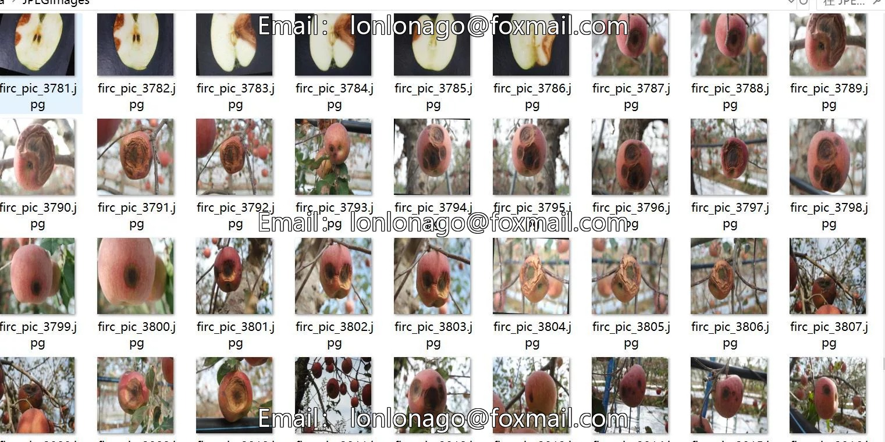
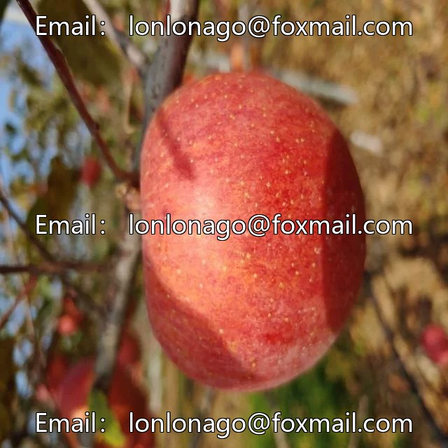
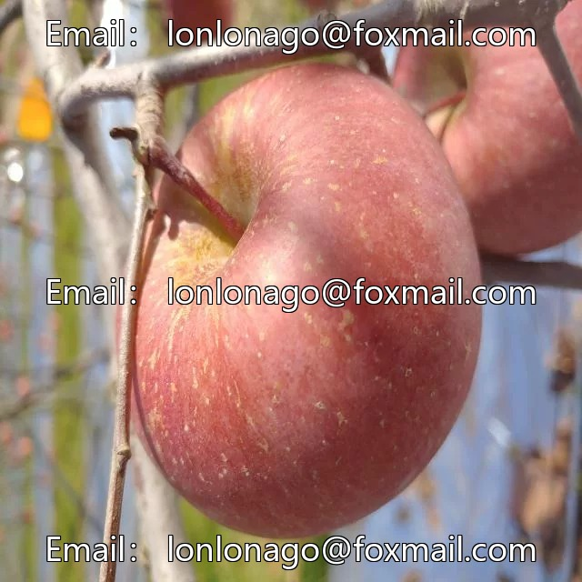
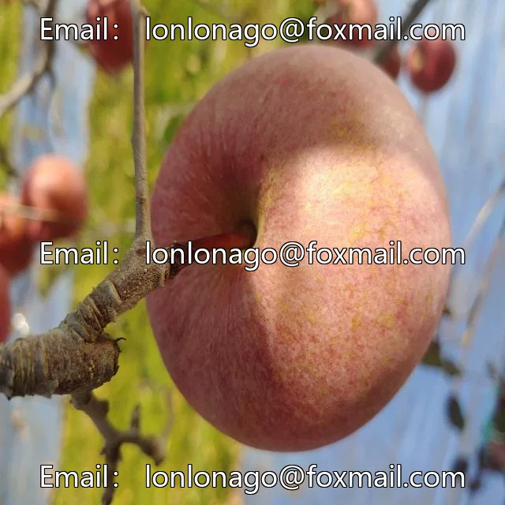

# Apple fruit quality inspection dataset in VOC+YOLO format with 4723 images in 2 categories

## Body

Apple Fruit Quality Inspection Dataset (VOC+YOLO format, 4723 images in 2 categories)

Warm Reminder: Due to the dataset's replicability, please confirm compliance with requirements before purchasing.

Dataset Format: Pascal VOC format + YOLO format (txt files without split paths, only containing jpg images and corresponding VOC format xml files and yolo format txt files).
Number of Images (Total number of jpg files): 4723
Number of Annotations (Total number of xml files): 4723
Number of Annotations (Total number of txt files): 4723
Number of Annotation Categories: 2

Label categories (note that the order of labels in the YOLO format does not correspond to this, but is based on the classes.txt file in the labels folder): ["bad", "good"]
Number of boxes per category
Bad: 1777
Good: 2946
Total boxes: 4723
Number of images per category
Bad: 1777
Good: 2946
Image resolution: 640x640
Labeling tool used: labelImg
Labeling rules: Draw a rectangle around the category
Important note: The dataset does not have splits for training, validation, and testing; you will need to manually divide it.

Special : This dataset does not guarantee the accuracy of the trained models or weight files.

## Images

## Payment

Here is a pay link on Stripe ( https://buy.stripe.com/3cs8yP7sY87d0vu9AB ). Please contact me lonlonago@foxmail.com after funding $89, and I will send you a complete data files , thank you!

